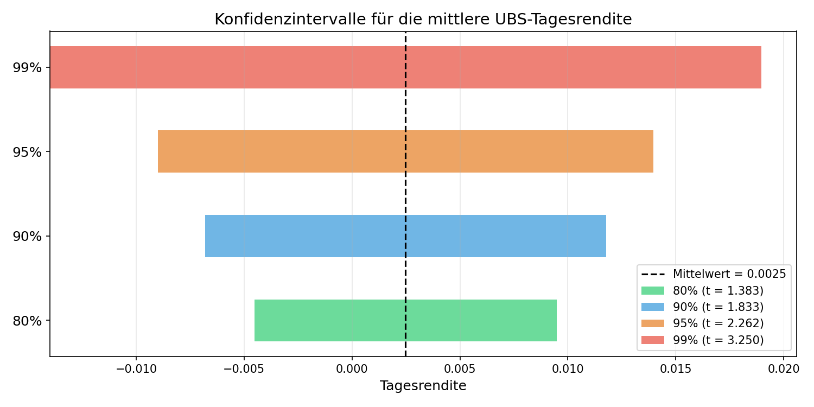

<div align="center">

# UBS-Aktie: Renditen und Konfidenzintervalle

**Statistik-Übung (ZHAW) mit echten Kursdaten der UBS Group AG**


[Aufgabenstellung](#aufgabenstellung) · [Vorgehen](#vorgehen) · [Ergebnis](#ergebnis) · [Ausführen](#ausführen)

</div>

---

## Aufgabenstellung

Anhand der Schlusskurse der UBS-Aktie (`UBSG.SW`, SIX Swiss Exchange) aus elf Handelstagen im
März 2025 werden die Tagesrenditen untersucht und die mittlere Tagesrendite mit Konfidenzintervallen geschätzt.

## Vorgehen

| Skript | Inhalt |
|---|---|
| [`aufgabe_c.py`](aufgabe_c.py) | Kursdaten laden, Tagesrenditen, Mittelwert, Standardabweichung und Standardfehler |
| [`aufgabe_d.py`](aufgabe_d.py) | Konfidenzintervalle (80 %, 90 %, 95 %, 99 %) mit der t-Verteilung (df = n − 1) und Grafik |

Verwendete Formeln:

- Tagesrendite: $r_t = \frac{P_t - P_{t-1}}{P_{t-1}}$
- Standardfehler: $SE = \frac{s}{\sqrt{n}}$
- Konfidenzintervall: $\bar{r} \pm t_{1-\alpha/2,\,n-1} \cdot SE$

## Ergebnis

<p align="center">
  
</p>

Je höher das Konfidenzniveau, desto breiter das Intervall. Bei nur zehn Renditen ist die Unsicherheit
entsprechend gross.

## Ausführen

```bash
git clone https://github.com/mat058/ZHAW---UBS_Statistik.git
cd ZHAW---UBS_Statistik
pip install -r requirements.txt
python aufgabe_c.py
python aufgabe_d.py
```

Die Kursdaten werden beim Ausführen live über Yahoo Finance geladen.
